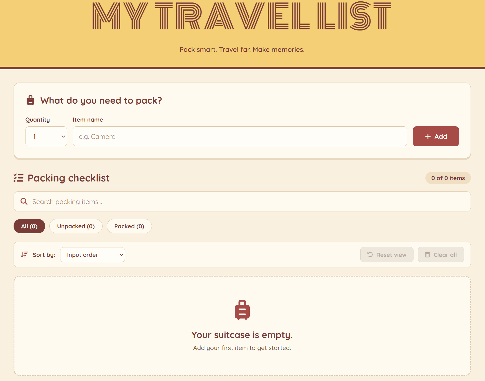
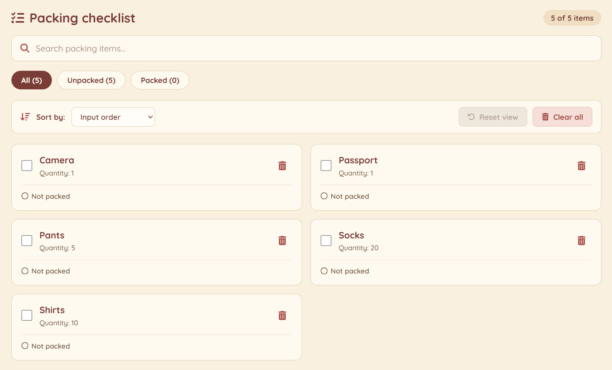
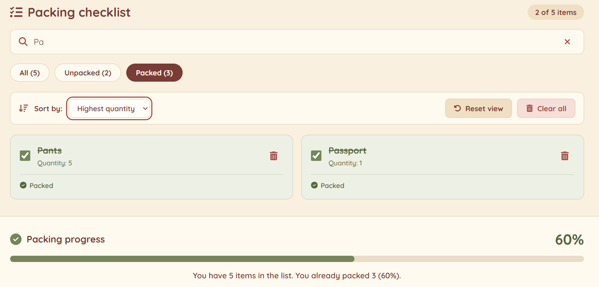
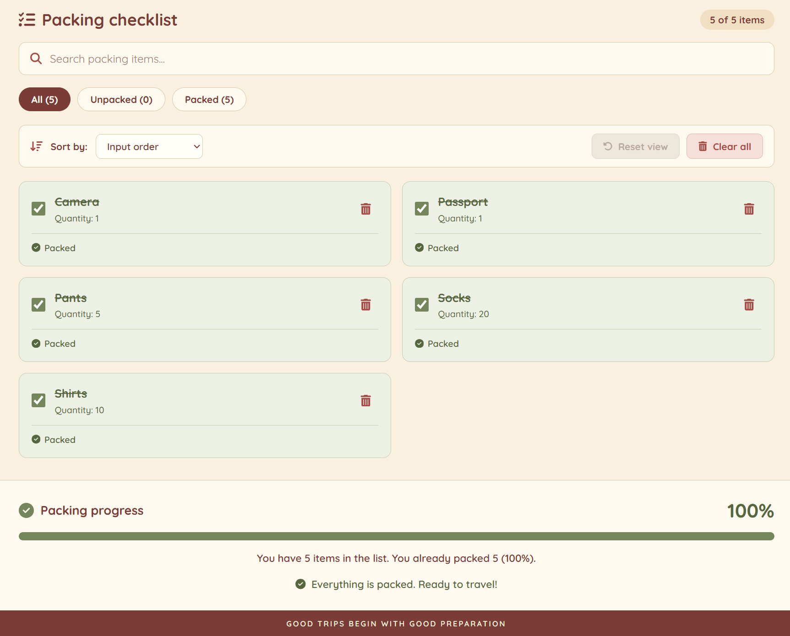
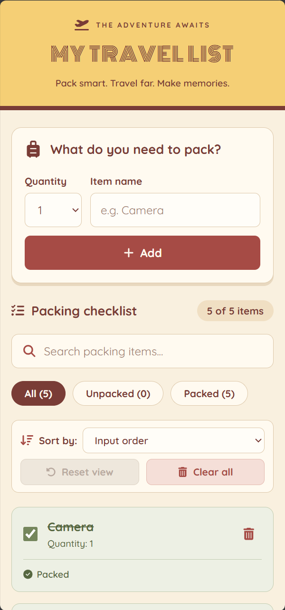

# My Travel List

## Project Overview

My Travel List is a React-based travel packing list application developed for the C304 Cloud Application Development module at Republic Polytechnic.

The application helps users organise their travel essentials by allowing them to add items, select quantities, mark items as packed, and track their overall packing progress.

The application features a custom Retro Vacation theme inspired by vintage travel designs, using warm colours, the Monoton font, and Font Awesome 6 icons.

## Live Demo

[View My Travel List](https://my-travel-list-lime.vercel.app/)

## Features

### Core Features

- Add packing items with a description and quantity.
- Display packing items in a responsive card layout.
- Mark items as packed or unpacked using checkboxes.
- Delete individual packing items.
- Calculate and display packing completion statistics.

### Extended Features

- Case-insensitive search by item description.
- Filter items by All, Packed, and Unpacked status.
- Dynamic item counts for each filter.
- Sort items using five different options:
  - Input order
  - Name (A-Z)
  - Name (Z-A)
  - Highest quantity
  - Unpacked first
- Clear all packing items with confirmation.
- Reset search, filter, and sorting options.
- Select quantities from 1 to 20.
- Dynamic packing progress bar.
- Completion message when all items are packed.
- Empty-list and no-result messages.
- Responsive desktop and mobile layouts.

## Screenshots

### Empty Packing List

### Packing List

### Search and Filter

### Completed Packing List

### Mobile Layout

## Technologies Used

- React
- JavaScript
- HTML5
- CSS3
- React Icons (Font Awesome 6)
- Google Fonts (Monoton and Quicksand)
- Node.js and npm
- Git and GitHub

## React Concepts Applied

- Function components
- JSX
- Props
- Callback functions
- Event handling
- Conditional rendering
- Controlled components
- State management using useState
- Lifting state up
- Derived values
- Array rendering using map()
- Array filtering using filter()
- Component modularisation

## Component Structure

    App
    ├── Logo
    ├── Form
    ├── PackingList
    │   ├── PackingToolbar
    │   └── Item (multiple instances)
    └── Stats

### Component Responsibilities

| Component | Responsibility |
|---|---|
| App | Manages the shared packing list state and item handler functions. |
| Logo | Displays the application title and branding. |
| Form | Handles item descriptions, quantities, and form submission. |
| PackingList | Manages search, filter, and sorting logic and renders packing items. |
| PackingToolbar | Displays search, filter, sorting, reset, and clear-all controls. |
| Item | Displays individual packing items and handles toggle and delete interactions. |
| Stats | Displays packing statistics and completion progress. |

## Project Structure

    src/
    ├── components/
    │   ├── App.js
    │   ├── Logo.js
    │   ├── Form.js
    │   ├── PackingList.js
    │   ├── PackingToolbar.js
    │   ├── Item.js
    │   └── Stats.js
    ├── index.js
    └── index.css

## Getting Started

### Prerequisites

- Node.js
- npm
- Git

### Installation

1. Clone the repository.

       git clone https://github.com/ZhengChengchao/Travel-List-App.git

2. Navigate to the project directory.

       cd Travel-List-App

3. Install the required dependencies.

       npm install

4. Start the development server.

       npm start

5. Open http://localhost:3000 in your browser.

## Production Build

To generate an optimised production build:

    npm run build

The production files will be generated in the build folder.

## Current Limitations

- Packing statistics are calculated based on list entries rather than individual physical quantities.
- Packing items are stored in React state and are reset when the page is refreshed.
- The application does not currently use a backend or database.

## Acknowledgements

This project was developed based on the C304 Lessons 11 and 12 Travel List App practical activities.

Starter repository:
https://github.com/andytaotest/travel-list-app-starter

The original starter application was extended with custom styling, additional features, and modular components.

## Author

Zheng Chengchao

Diploma in Information Technology (Full Stack Development)

Republic Polytechnic

C304 Cloud Application Development
